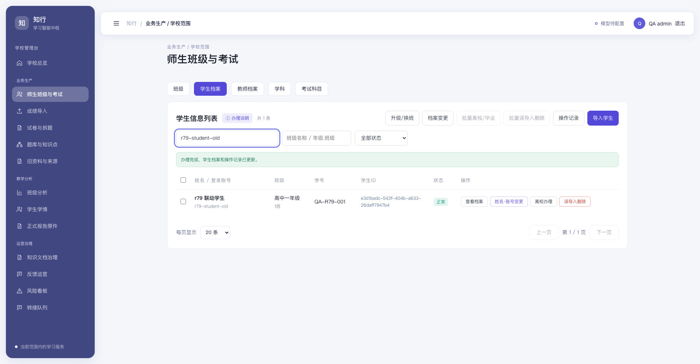
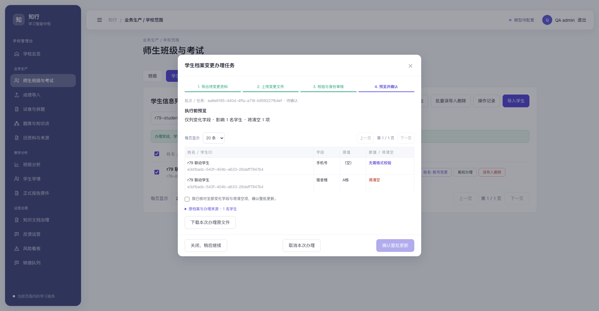
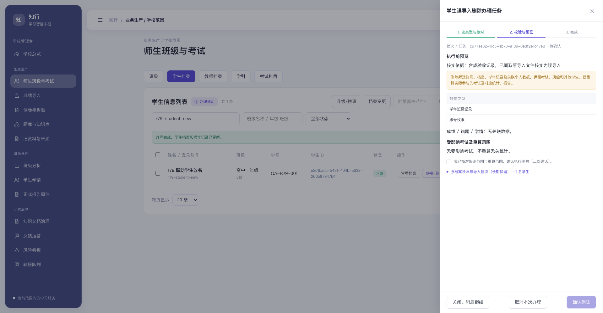
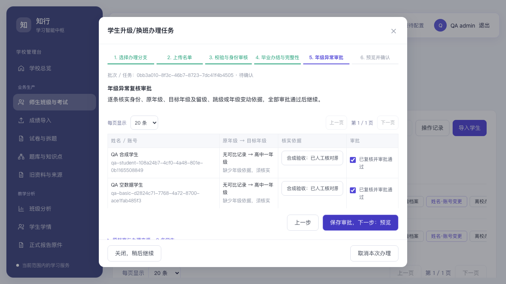

# 学生档案 r79 验收

日期：2026-10-12。测试均使用独立 PostgreSQL/SQLite 数据库、合成账号和临时随机凭据，未在生产库创建验收学生。

| 验收 | 结果 |
| --- | --- |
| 30 列导入、文件内/库内同班同名确认、放弃行、初始密码与首登改密 | 通过 |
| 31 列原值导出、8 字段锁定、全部重复ID错误、普通字段清空、保留学生ID | 通过 |
| 身份存疑停止写入、不能绕过待审核、通过后同任务继续、拒绝/取消无更新 | 通过 |
| 单条姓名同名确认、账号跨类型空间独立、旧账号/旧会话失效、原密码保留 | 通过 |
| 当前学年换班、下一学年全校名单/毕业核实/留级依据/年级异常审批 | 通过 |
| 离校、毕业、同学段恢复、不同类型名单整批失败、跨学段恢复拦截 | 通过 |
| 关联个人数据及后代删除、保留其他学生、保留无关考试/年级/班级统计、相关报告统计刷新 | 通过 |
| 原始快照/账号/导入批次保留、原文件下载、缺失历史文件明确标识 | 通过 |
| 并发重复确认一次提交、一次日志；范围隔离与管理员写入限制 | 通过 |
| 长 UTF-8 账号完整密码验证、普通字段原值保留、正式账号特殊名称首登 | 通过 |
| 全校切换后原班级历史考试分析仍能查询原参加学生 | 通过 |

后端验收代码：`apps/api/tests/test_student_r79.py`。实际浏览器验收：`tests/education/student-r79.spec.ts`，入口 `tests/education/run-student-r79.mjs`，只能指定名称含 `student_r79_browser` 的隔离数据库运行。

完整回归 PostgreSQL 237 项通过、SQLite 230 项通过（7 项需 PostgreSQL），后续专项 48 项通过；前端 18 项单元测试、lint、类型检查与构建通过。浏览器 3 项长流程全部通过。所有截图只含合成数据。

