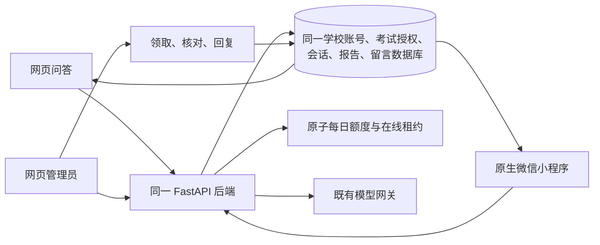

# 微信小程序实现与验收 · 2026-10-20

## 需求基线

- 用户附件：`学科智能问答小程序_高保真原型(1).html`。
- SHA-256：`974d294ee255c3a41b53c824c27646ad78163ff611eb4f7880c9da7d43ed8785`。
- 附件包含师生演示快照，仅本地读取，不上传原始附件。验收使用隔离 PostgreSQL、合成账号和合成成绩／PDF。
- 范围：原型已有流程，加用户明确要求的每日 100 次额度、剩余提醒、拥堵提醒和两端同步。开发者工具的原生项目为 `apps/miniprogram`。

## 链路



同步周期为前台 30 秒，进入前台、切页及提交后主动刷新；授权与文件访问均由服务端重新判定。没有新增独立小程序账号、独立成绩库或后台管理副本。

额度规则与 1000 人边界见 [小程序说明](../../../apps/miniprogram/README.md)。拥堵提示是在线人数的功能分类，不代表已完成 1000 人实际并发容量测试。

## 已完成的验证

| 验证 | 环境与结果 |
| --- | --- |
| 微信 WXML 与 WXSS 编译 | 使用本机微信开发者工具附带的 `wcc`、`wcsc` 编译通过 |
| 小程序静态检查 | JSON、JavaScript 语法、页面文件、无 `web-view` 检查通过 |
| 既有问答后台回归 | 19 项通过 |
| PostgreSQL 功能与并发 | 46 项通过；覆盖额度、最后一次并发、重试、午夜、退款、1001 个真实租约的边界分类、鉴权及同网段账号隔离 |
| 后端完整回归（SQLite） | 347 项通过，9 项 PostgreSQL 专属测试跳过；额度并发等关键测试另在 PostgreSQL 完整执行 |
| 额度与拥堵界面 | 网页、手机网页第100次丢响应重试、刷新持久化和五个人数边界，3 项通过 |
| 网页端到端验收 | 原型提示词发布、人工留言闭环、移动交互、双页 PDF 与撤权、丢响应重试 5 条流程通过 |
| 网页 lint／单测／构建 | lint 通过，31 项单测通过，生产构建通过 |
| 原生 Page 与真实 API 联调 | 直接加载交付的 Page/API 模块，对真实 FastAPI 与 PostgreSQL 完成 14 条业务链路；仅设备 API 做适配，登录、业务响应、权限和数据库均无模拟 |

原生 Page 联调覆盖：

1. 原学校账号登录与后台身份范围。
2. 自然语言问答、真实导入分数、报告来源和网页回读。
3. 网页向同一会话追问后小程序继续。
4. 来源检查、报告筛选、真实双页 PNG 预览与原始 PDF 字节下载。
5. 回答反馈关联原问题与回答，丢响应重试只创建一条留言。
6. 管理员领取回复、用户未读提醒、查看和追加回到待处理。
7. 再次回复、用户关闭、教师与学生隔离。
8. 问答丢响应后同一请求标识重试，次数只扣一次。
9. 每日第 101 次服务端阻断，仍可看报告及留言。
10. 管理员撤权后报告、已打开图片和历史答复隐藏，下一页访问被阻断。
11. 退出清空本机身份、草稿、会话、留言与临时文件。
12. 访问令牌失效时自动刷新，并发请求仅刷新一次。
13. 切换账号后丢弃旧账号延迟返回的数据。
14. 刷新凭据失效后清空历史数据并返回登录。

## 尚需人工配合的环节

1. **原生开发者工具运行及视觉验收**：本次检查时 Mac 锁定，开发者工具服务端口关闭。已向用户反馈并请求解锁、开启端口；尚不能将编译或 Page/API 联调表述为开发者工具实机运行通过。可执行的原生烟雾脚本已准备为 `npm run test:mini:devtools`，运行后保存实际截图与结果。
2. **正式 AppID**：用户暂未注册，当前项目为 `touristappid`。注册、管理员微信扫码和认证需要用户完成。
3. **正式 HTTPS 域名**：用户暂未准备。后续配置 request 与 downloadFile 合法域名，并进行关闭调试模式的真机验证。
4. **上线服务**：GitHub 推送不等于生产发布。本次新增数据库迁移必须与后端版本一起发布，随后才能让正式网页与正式微信端共用新额度、人数功能。

## 部署顺序

1. 为现有服务和数据库做备份，记录当前镜像与版本。
2. 使用包含本次改动的版本构建 API 与 Web。
3. 在同一个业务数据库执行 `alembic upgrade head`，版本应为 `025_answer_usage_presence`。迁移只新增 `answer_daily_usage` 和 `answer_presence` 两表。
4. 启动服务，核对健康接口、真实模型就绪状态、网页登录及管理员人工留言。
5. 配置固定 HTTPS 域名和有效证书，将同一域名加入微信的 request／downloadFile 合法域名。
6. 使用真实 AppID 与域名运行 `mini:configure`，再执行 `mini:check -- --release`。
7. 开发者工具及真机验证后上传体验版；用户管理员完成审核／发布。

## 重跑测试

本地隔离服务由 `tests/miniprogram/serve.mjs` 提供。需要 Python 虚拟环境、Web 依赖和显式创建的临时 PostgreSQL 数据库，库名须含 `exam_v17_browser`：

```bash
export QA_WECHAT_DATABASE_URL='postgresql+asyncpg://用户:密码@127.0.0.1:端口/exam_v17_browser_wechat_临时库'
export QA_WECHAT_OUTPUT='/绝对路径/私有验收输出目录'
node tests/miniprogram/serve.mjs
```

服务监听 `127.0.0.1:8048`，网页为 `127.0.0.1:5230`。测试账号与临时口令只写入输出目录中权限为 600 的 `fixtures.json`，不输出口令，不入 Git。

另一终端使用同一 `QA_WECHAT_OUTPUT`：

```bash
npm run mini:configure -- --api http://127.0.0.1:8048/api/v1 --local
npm run test:mini:flows
npm run test:mini:devtools
```

隔离服务显式使用 `MODEL_PROVIDER=fake`，目的是稳定验证真实业务链路；没有把测试模型接到生产。真实模型的回答质量仍由现有网关和发布流程验证。

自动化入口与服务端口要求见 [微信官方自动化快速入门](https://developers.weixin.qq.com/miniprogram/dev/devtools/auto/quick-start.html)。

## 执行记录

测试私有输出保存在本机 `.local/wechat-mini/`；该目录被 Git 忽略，包含测试凭据的文件不随代码提交。

最终本机结果：后端完整回归 `347 passed / 9 skipped`；关键 PostgreSQL `46 passed`；前端 `31 passed`；网页业务流程 `5 passed`；额度与拥堵界面 `3 passed`；原生 Page + 真实 API `14 passed`。开发者工具原生运行、真机与正式上线仍按上述人工环节执行。
