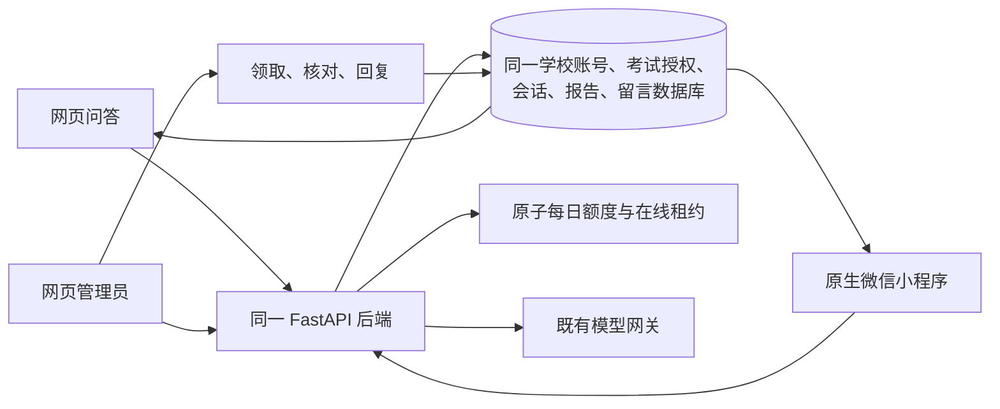

# 微信小程序实现与验收 · 2026-10-20

## 需求基线

- 用户附件：`学科智能问答小程序_高保真原型(1).html`。
- SHA-256：`974d294ee255c3a41b53c824c27646ad78163ff611eb4f7880c9da7d43ed8785`。
- 附件包含师生演示快照，仅本地读取，不上传原始附件。功能回归使用隔离 PostgreSQL、合成账号和合成成绩／PDF；正式数据与真实模型补验另见末节。
- 范围：原型已有流程，加用户明确要求的每日 100 次额度、剩余提醒、拥堵提醒和两端同步。开发者工具的原生项目为 `apps/miniprogram`。

## 链路



同步周期为前台 30 秒，进入前台、切页及提交后主动刷新；授权与文件访问均由服务端重新判定。没有新增独立小程序账号、独立成绩库或后台管理副本。

额度规则与 1000 人边界见 [小程序说明](../../../apps/miniprogram/README.md)。拥堵提示是在线人数的功能分类，不代表已完成 1000 人实际并发容量测试。

## 已完成的验证

| 验证 | 环境与结果 |
| --- | --- |
| 微信 WXML 与 WXSS 编译 | 使用本机微信开发者工具附带的 `wcc`、`wcsc` 编译通过 |
| 小程序静态检查 | JSON、JavaScript 语法、页面文件、无 `web-view` 检查通过 |
| 既有问答后台回归 | 19 项通过 |
| PostgreSQL 功能与并发 | 46 项通过；覆盖额度、最后一次并发、重试、午夜、退款、1001 个真实租约的边界分类、鉴权及同网段账号隔离 |
| 后端完整回归（SQLite） | 合并正式站权限修复后 350 项通过，9 项 PostgreSQL 专属测试跳过；额度并发等关键测试另在 PostgreSQL 完整执行 |
| 额度与拥堵界面 | 网页、手机网页第100次丢响应重试、刷新持久化和五个人数边界，3 项通过 |
| 网页端到端验收 | 原型提示词发布、人工留言闭环、移动交互、双页 PDF 与撤权、丢响应重试 5 条流程通过 |
| 网页 lint／单测／构建 | lint 通过，31 项单测通过，生产构建通过 |
| 微信开发者工具实际运行 | 2026-10-20 16:04 完成，隔离业务库与测试模型下 15 项原生界面与业务检查通过，0 个运行异常；10 张截图保存在私有验收目录 |
| 原生 Page 与真实 API 联调 | 隔离业务库与测试模型下，直接加载交付的 Page/API 模块，对真实 FastAPI 与 PostgreSQL 完成 14 条业务链路；仅设备 API 做适配，登录、业务响应、权限和数据库均无模拟 |
| 正式账号原生界面与真实模型 | 由持有人正常登录已有学生账号，实际输入、发送、查看来源、后台回读、历史重开及次数核对通过；DeepSeek Flash，非测试模型，最后一轮约 3.1 秒，0 个原生运行异常 |

原生 Page 联调覆盖：

1. 原学校账号登录与后台身份范围。
2. 自然语言问答、真实导入分数、报告来源和网页回读。
3. 网页向同一会话追问后小程序继续。
4. 来源检查、报告筛选、真实双页 PNG 预览与原始 PDF 字节下载。
5. 回答反馈关联原问题与回答，丢响应重试只创建一条留言。
6. 管理员领取回复、用户未读提醒、查看和追加回到待处理。
7. 再次回复、用户关闭、教师与学生隔离。
8. 问答丢响应后同一请求标识重试，次数只扣一次。
9. 每日第 101 次服务端阻断，仍可看报告及留言。
10. 管理员撤权后报告、已打开图片和历史答复隐藏，下一页访问被阻断。
11. 退出清空本机身份、草稿、会话、留言与临时文件。
12. 访问令牌失效时自动刷新，并发请求仅刷新一次。
13. 切换账号后丢弃旧账号延迟返回的数据。
14. 刷新凭据失效后清空历史数据并返回登录。

## 尚需人工配合的环节

1. **真机验收**：开发者工具运行与视觉验收已完成。正式 AppID、HTTPS 域名配置后，仍需在真实手机关闭调试模式后验收。服务端口已确认开启（20046），无需用户再次寻找开关。
2. **正式 AppID**：用户暂未注册，当前项目为 `touristappid`。注册、管理员微信扫码和认证需要用户完成。
3. **正式 HTTPS 域名**：用户暂未准备。后续配置 request 与 downloadFile 合法域名，并进行关闭调试模式的真机验证。
4. **上线状态**：API 与网页已部署 `069411cbe033a494f04b755f075e1216b9c866f1`，数据库迁移至 `025_answer_usage_presence`，每日额度和在线人数接口已在正式后台启用。微信小程序尚未提交审核或发布，仍待真实 AppID、HTTPS 合法域名及真机验收。
5. **当前账号的报告授权**：持有人本轮登录的账号有 2 场已授权考试、0 份已授权报告；成绩问答已验证。如果需要该账号解读诊断报告，学校管理员还需通过既有网页管理流程上传并开放相应报告。

## 部署顺序

1. 为现有服务和数据库做备份，记录当前镜像与版本。
2. 使用包含本次改动的版本构建 API 与 Web。
3. 在同一个业务数据库执行 `alembic upgrade head`，版本应为 `025_answer_usage_presence`。迁移只新增 `answer_daily_usage` 和 `answer_presence` 两表。
4. 启动服务，核对健康接口、真实模型就绪状态、网页登录及管理员人工留言。
5. 配置固定 HTTPS 域名和有效证书，将同一域名加入微信的 request／downloadFile 合法域名。
6. 使用真实 AppID 与域名运行 `mini:configure`，再执行 `mini:check -- --release`。
7. 开发者工具及真机验证后上传体验版；用户管理员完成审核／发布。

## 重跑测试

本地隔离服务由 `tests/miniprogram/serve.mjs` 提供。需要 Python 虚拟环境、Web 依赖和显式创建的临时 PostgreSQL 数据库，库名须含 `exam_v17_browser`：

```bash
export QA_WECHAT_DATABASE_URL='postgresql+asyncpg://用户:密码@127.0.0.1:端口/exam_v17_browser_wechat_临时库'
export QA_WECHAT_OUTPUT='/绝对路径/私有验收输出目录'
node tests/miniprogram/serve.mjs
```

服务监听 `127.0.0.1:8048`，网页为 `127.0.0.1:5230`。测试账号与临时口令只写入输出目录中权限为 600 的 `fixtures.json`，不输出口令，不入 Git。

另一终端使用同一 `QA_WECHAT_OUTPUT`：

```bash
npm run mini:configure -- --api http://127.0.0.1:8048/api/v1 --local
npm run test:mini:flows
npm run test:mini:devtools
```

隔离服务显式使用 `MODEL_PROVIDER=fake`，目的是稳定验证真实业务链路；没有把测试模型接到生产。真实数据与模型补验另行使用现有正式后台，结果见下方专节。

自动化入口与服务端口要求见 [微信官方自动化快速入门](https://developers.weixin.qq.com/miniprogram/dev/devtools/auto/quick-start.html)。

## 执行记录

测试私有输出保存在本机 `.local/wechat-mini/`；该目录被 Git 忽略，包含测试凭据的文件不随代码提交。

最终本机结果：后端完整回归 `350 passed / 9 skipped`；关键 PostgreSQL `46 passed`；前端 `31 passed`；网页业务流程 `5 passed`；额度与拥堵界面 `3 passed`；原生 Page + 真实 API `14 passed`。微信开发者工具隔离回归另有 15 项通过、0 运行异常；正式账号及真实模型界面补验见末节。真机与正式上线仍按上述人工环节执行。

### 开发者工具补验记录

- 使用官方 `miniprogram-automator` 操作本机微信开发者工具 Stable 2.02.2608080，基础库 3.7.12，iPhone 12/13 模拟器。
- 覆盖原账号登录、自然语言提问、真实次数扣减、工具、历史、留言提交、管理员回复、追加、关闭、账号隔离、报告筛选、双页 PDF、实际下载字节核对、撤权清空与个人信息页。
- 实际渲染发现并修复 WXML 条件表达式缺少插值绑定，以及微信 v2 默认按钮宽度覆盖原型布局的问题；静态检查新增动态绑定校验。
- 实际截图及结果：`.local/wechat-mini/session/devtools/`，不含正式账号凭据。
- 初始实现提交 `db84beaa` 的 GitHub CI 已全部通过：[运行记录](https://github.com/fengsihao23-eng/zhineng-wenda-zhushou/actions/runs/39387763829)。本次界面修复随补验结果继续推送。

## 正式数据与真实 DeepSeek 补验（2026-10-20）

用户进一步明确要求验证“现有网页后台的数据能否接入、小程序能否正常问答”，因此没有把测试模型的通过结果当作真实模型验收。

### 版本与部署

- 核对发现正式站为 `af382dddb48b4b9fd7c7d7cadb3fbd2323368f00`，包含较新的权限与登录修复，尚无新增额度、在线人数接口。
- 已先合并该正式版本，保留权限／登录修复，再发布 `dbb66afd5e23c571d54532a1dff4bebe83d2877a`。合并后 SQLite 回归 `350 passed / 9 skipped`，关键 PostgreSQL `46 passed`，前端 `31 passed`、lint 和生产构建通过。
- 服务器备份：`/srv/backups/wechat-native-20261020-083402Z`；迁移仅新增两表，原业务表数量核对一致，模型环境配置未改动，服务健康检查与前端资源核验通过。
- 小程序开发配置已改为现有网页后台 `http://43.161.195.51/api/v1`，不再默认指向隔离测试服务。此 HTTP 地址仅用于开发者工具联调。
- 正式账号界面补验发现模型将报告状态的内部字段写进答复，已在系统提示中要求使用自然中文，并部署 `069411cbe033a494f04b755f075e1216b9c866f1`；备份为 `/srv/backups/wechat-native-20261020-091320Z`。问答后台 19 项定向回归通过，生产健康、源文件散列、网页静态资源及原业务数据数量核对通过；模型环境配置保持原值。

### 实测结果

使用已有已激活学生账号的现有授权，由正式服务签发短时验收会话。没有修改该账号密码、角色、考试成绩或报告。

1. 从微信开发者工具发出真实 `wx.request`，读取该账号已授权的 **2 场考试、1 份报告**，与网页所用 API 读取结果一致。
2. 实际下载访问其中一份已授权报告的当前版本页面，HTTP 200；保持原有报告权限。
3. 发出一条带“联调核验”标记的真实成绩与建议问题，收到有来源的非兜底回答；返回的得分表与正式数据库原始记录一致。
4. 正式后台状态为 `environment=production`、`provider=deepseek`、`model=deepseek-flash`、`test_model_enabled=false`。本轮真实问答没有使用模型 mock。
5. 网页端同一 API 能回读同一会话、同一回答 ID 与相同文本，确认不是独立小程序测试库。
6. 该请求扣减 1 次日额度；同一请求标识重试保持同一会话、相同消息数及相同额度。
7. 结束后已通过 `/auth/logout` 撤销本次短期验收会话（HTTP 204）。正式库保留 1 条已标记的联调问答历史。

结果：正式后台数据、真实模型问答、报告访问、网页回读、幂等与次数扣减已实测跑通。**仍不能据此承诺所有功能已完善或已具备正式微信上线条件**：正式 AppID、HTTPS 合法域名、手机实机与实际高并发容量验证仍需完成。

不含姓名、得分、会话凭据的汇总：`.local/wechat-live/live-result.json`；正式数据、问答内容和验收凭据仅保存在被 Git 忽略的私有验收目录，不上传公开仓库。

### 持有人正常登录后的原生界面补验

用户已在本机打开小程序，并用已有学生账号正常登录。本次沿用该真实登录，通过官方开发者工具自动化执行交付页面；没有读取、导出或替换持有人的登录凭据。

1. 读取当前账号的 2 场已授权考试、0 份已授权报告，使用其中一场考试的原有科目提问。
2. 实际在原生输入框填写带“界面联调核验”标记的问题，并点击发送按钮；不是直接调用问答接口代替页面交互。
3. 正式 DeepSeek Flash 返回非兜底回答，并实际渲染在聊天页面；文案修正后的最后一轮耗时 3092 毫秒，不再含报告状态的内部字段。
4. 点击回答下方的成绩来源，确认来源仍获授权、仅含学生本人；回答表中的分数和满分与同一正式后台的成绩来源一致。
5. 从网页问答使用的同一 API 回读，确认会话、回答 ID、回答文本与原生页面一致。
6. 页面及后台的每日已用次数均只增加 1；界面测试与脚本重跑共保留 4 条带明确标记的问答，每条各计 1 次，没有修改成绩、报告、密码、身份或权限。
7. 通过“学习工具 → 历史会话”重新打开该问答，确认同一回答继续可见；保留持有人的登录与问答页面。
8. 最后一轮 0 个原生运行异常。自动化曾在页面数据变化后过早点击，现已等待实际元素渲染再操作，重跑完整链路通过。

入口为 `QA_WECHAT_LIVE_UI=1 npm run test:mini:live-ui`。脚本默认不会在 CI 或未显式开启时向正式环境提问。脱敏汇总保存在 `.local/wechat-live/live-ui-result.json`；含业务数据的截图和详细证据仅本机私有保存。
