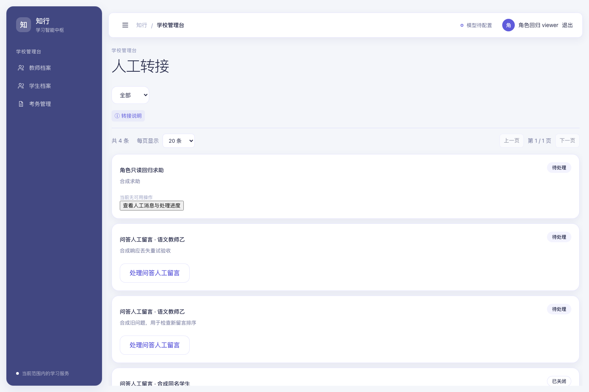
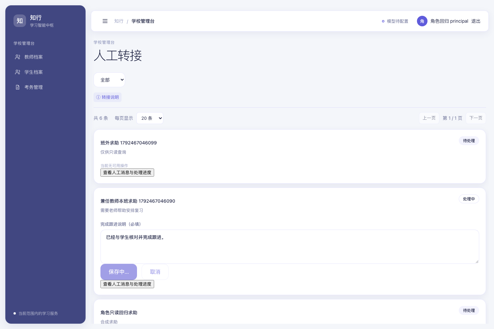
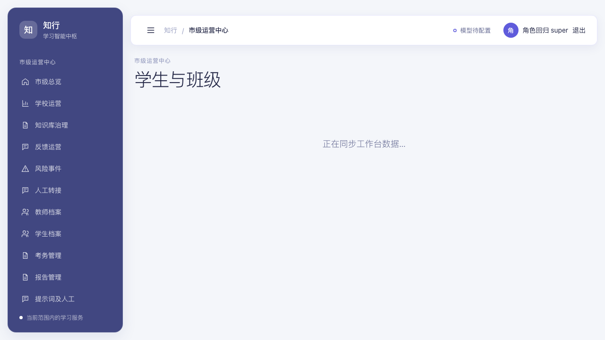
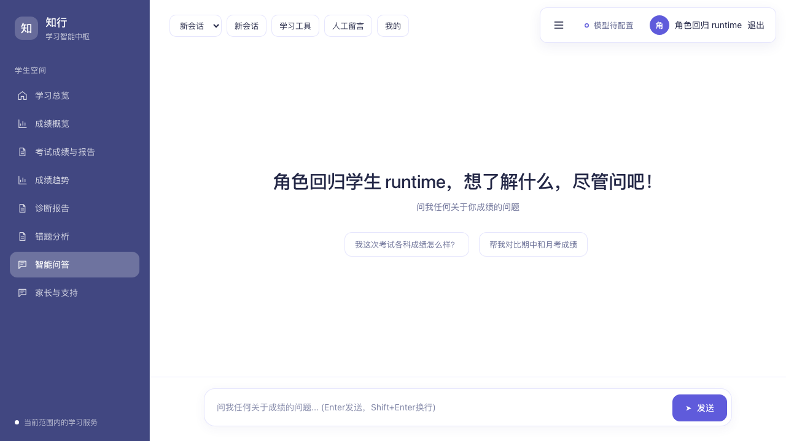

# 角色权限与登录流程修复

日期：2026-10-20（北京时间）。基于线上版本 `e5645bc2`。

## 修复结果

1. 纯学校只读账号可读取总览、学生、反馈、风险、转人工及相关详情。返回数据不提供其无权执行的状态流转、领取和回复操作；写入仍由后台拒绝，跨校数据仍不可见。
2. 教师兼学校只读职务可处理任教或明确授权学生范围内的求助工单，包括接单、回复和完成；学校只读职务保留全校查询范围，但不能借此处理范围外学生。问答人工留言采用相同规则。其他只读写入限制保留。
3. 超级管理员可从班级分析进入“查看学情”，并返回学生列表。管理页前端角色与后台允许角色一致。
4. `/mini-preview` 校验登录状态和教师／学生身份。未登录者进入登录页，不支持的管理员身份显示权限提示；预览加载失败可重试或返回工作台，不触发全局登出。
5. 问答运行期间收到真实 `403 PASSWORD_CHANGE_REQUIRED` 时进入修改密码页；完成改密后可继续问答。原先正常的初次登录改密流程保留。
6. 回归时发现桌面空白问答的消息区域会遮住头部“人工留言”按钮，已调整头部层级，正常点击即可进入。预览脚本和桌面样式资源增加版本参数。

“教师兼考务管理员”通过实际登录对照，教学学生集合、学科成绩、班级分析样本及班外拒绝结果一致，未复现教学数据范围扩大。考务角色继续拥有其被授予的考务管理入口。

## 验证方式与结果

- 新增真实认证回归，不替换 `get_current_user`。覆盖纯只读读取、禁止写入、兼任教师本班回复与完成、班外拒绝、跨校隔离，以及人工留言领取与回复。
- 受影响后台套件：SQLite 51 通过、1 项 PostgreSQL 并发专用测试跳过；PostgreSQL 52 通过。最终角色专项 PostgreSQL 3 通过。
- 前端单测 31 通过，ESLint、TypeScript 和生产构建通过。
- Chromium 使用生产前端构建、隔离 PostgreSQL、真实登录和实际 HTTP 接口：角色专项 5 项、桌面问答 5 项、小程序问答 5 项、考务管理 15 项通过。
- 角色专项的新增师生身份会改变同校人数，须按 `validation.json` 说明与使用固定人数断言的考务套件分别运行。首次合跑两项固定人数断言失败，分开使用各自种子后全部通过。
- 所有写入测试只针对合成数据；没有为测试修改线上角色、密码、查询授权或真实工单。

## 页面证据

## 发布校验

`scripts/server/deploy_role_access.sh` 使用 `ubuntu + sudo -n`，备份数据库并保留回滚镜像，构建 API 与 Web，校验活动源码和前端资源、服务健康、环境文件、业务表计数及角色和考试授权摘要。没有数据库迁移或业务数据修复。

`scripts/server/verify_role_access.py` 仅执行 GET 和数据库查询，使用进程内的短效令牌核对正式环境可用身份，不输出令牌或学生内容。读取学情时会按现有系统行为记录访问审计。

## 线上发布（2026-10-20）

- 发布方式：`ubuntu@43.161.195.51` + `sudo -n bash scripts/server/deploy_role_access.sh`，从 `e5645bc2` 发布到 `af382ddd`，发布目录 `/srv/backups/role-access-20261020-034219Z`。
- 发布前已备份数据库（含备份目录清单）并保留 `api`、`web` 回滚镜像；环境文件哈希发布前后一致。
- 没有数据库迁移：schema 前后均为 `024_answer_workbench`。
- 业务数据未变化：用户 596、学生 332、教师档案 259、任课关系 2660、考试 4、查询策略 634、查询授权 9792、学科成绩 630、小题得分 25140、报告 25、角色关系 668、人工求助 0、问答工单 1；角色、教师档案、查询策略／授权、考务管理摘要前后一致。
- 活动 API 源码 6 个文件哈希与发布提交一致；前端资源 `index-CM0U-YOE.js`、`index-oUWgXBqI.css` 的容器内哈希与线上响应一致，`/admin/school`、`/admin/reports`、`/mini` 等路由返回正常。
- 生产健康检查 `status=ok`、`environment=production`、`real_model_ready=true`；`/api/v1/health` 公网返回正常，`/chat` 与 `/mini-preview` 返回 200。
- 只读线上角色核验：纯学校只读账号与兼任教师账号均可读取总览、学生、反馈、风险、转人工五类接口及学生详情，且不可执行状态流转、领取、回复；学校管理员账号读取正常。线上库当前没有 `SUPER_ADMIN` 账号，超级管理员学情下钻由隔离环境的真实登录与 Chromium 用例覆盖，未改动线上账号、角色、密码或授权。
- GitHub Actions 运行 `39364906606` 在 `af382ddd` 上通过（frontend、backend 均 success）。
- API 重启期间健康检查出现一次瞬时 502，重试后恢复 `ok`，未触发回滚。
