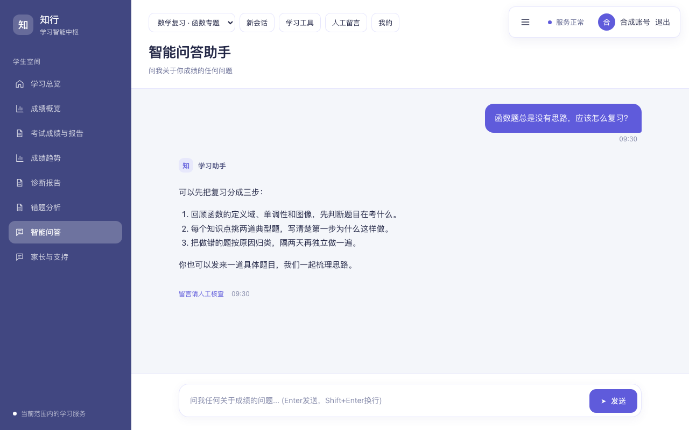

# 问答、任课关系、小题成绩与人工求助修复

日期：2026-10-20（北京时间）。

## 已修复的行为

1. 问答按创建时间倒序读取最近 100 个会话，客户端保持最新会话在前。第 101 个会话提交后、状态重载后、刷新页面后均可继续查看。更早的会话保留在数据库中。
2. 教师档案和考试权限预选共用班级解析，支持全角标点、换行、数字年级班号和“高中一年级26班”。创建或调整考试、班级或学科、导入 CSV、升级换班时，按当前有效教师档案幂等补建任课关系。已有结束或过期的关系不会因补建而恢复。教师导入回执明确提示未匹配引用。
3. 成绩文件可在固定表头后添加“满分”行，首列填写“满分”，各小题列填写该题满分。导入时校验并计算失分。只有得分的旧文件仍可导入，预校验明确提示缺少满分；学生错题页展示得分和“待补满分”，不将其判成错题。考务“查看已导入成绩 → 查看 / 补充小题满分”可补录，保存后计算已有成绩的失分，保留原文件和得分，记录操作。
4. 问答人工留言进入“学生人工求助”和首页人工转接待办。班主任、任课教师按现有学生范围查看、领取和回复；学生在原留言中查看回复、追加和结束。数据上下文还需同时满足学生与处理教师的来源权限。提示词维护继续要求学校管理员权限。

升级换班的追加回归还修正了班级外部编号回退查询的关联：回退只匹配当前学生及当前任课关系，避免其他未绑定班级的学生进入教师范围。

## 验证

- 合并服务器现有更新后，后端 SQLite 最终完整套件：334 通过、8 项 PostgreSQL 专用测试跳过；包含真实“先教师、再考试、再升级换班”回归。
- 新增与受影响后端定向回归：会话超过 100 条、重试幂等、教师先导入的两种建档顺序、生产式关闭 autoflush、结束及过期任课关系、小题满分导入和补录、越界满分、考试版本冲突、求助队列计数、跨班及跨校隔离、成绩来源权限与撤销。
- 前端单元测试：9 个文件、31 项通过。
- 前端 ESLint、TypeScript 与生产构建通过。GitHub CI 首次完整运行：SQLite 327 通过、8 跳过，PostgreSQL 335 全部通过。
- Chromium 专项测试：开发构建 5 项、实际生产构建 5 项全部通过，覆盖第 101 个会话刷新和重选、待补满分页面和原题详情、老师领取并回复问答人工留言，以及 1280px / 390px 的独立样式、消息对比度、输入框定位和横向溢出。
- 截图均使用合成身份与合成数据；浏览器测试拦截 API，用于验证交互和展示，真实后端读写由 HTTP/SQL 回归覆盖。

## 问答页面样式修复

原先问答 iframe 在加载时复制父页 stylesheet link，开发环境样式由 style 标签提供时会丢失基础样式。现将完整主题、消息、输入框和数学排版 CSS 在构建时打包并直接注入 iframe，去掉对父页样式标签的依赖。浏览器测试不再注入替代样式。

消息取消透明度入场动画，明确区分用户和助手，标题、导航、消息阅读列和底部输入框重新排版；手机导航使用完整下拉行和四等宽按钮。

生产构建浏览器测试使用 `tests/ui/playwright.production.config.ts`，从 `apps/web/dist` 启动预览。截图使用合成数据，不代表线上学生记录。

## 页面证据

## 部署与旧数据

使用 `scripts/server/deploy_workflow_gaps.sh`，由 `ubuntu` 登录后 `sudo -n` 执行。脚本备份数据库、校验备份目录、保留 API/Web 回滚镜像，再构建并发布。环境文件和数据库结构不变；校验活动镜像源码、公开前端资源以及业务数据摘要。

`apps/api/scripts/repair_workflow_gaps.py` 默认只预览并回滚；`--apply` 才提交。它补建有效档案缺少的任课关系，只对已知满分且失分为空的小题计算失分，不推算缺失满分。发布后再次预览必须没有可重复补建或修复的记录。

原文件缺少的小题满分仍需学校依据试卷或评分标准补录，不能用其他学生最高分代替。旧问答人工留言直接纳入统一队列，无需复制或迁移。

## 服务器发布结果

- 应用版本：`68f65363c009fcd9c4c888948592af56ed371046`，已合入服务器此前部署的报告阅读、上传滚动及已保存教师授权回显更新。
- 使用 `ubuntu + sudo -n` 发布，API、Web 重建后全部健康；数据库版本仍为 `024_answer_workbench`。
- 数据库备份已验证，回滚镜像保留；环境文件、师生档案、成绩得分、考试配置及查询授权摘要校验通过。
- 已执行一次修复并验证幂等：当前有效档案没有缺失任课关系，补建数为 0；没有满分已知而失分遗漏的记录。
- 当前有 **25,139 条**原始小题记录没有满分，已可在学生页展示得分和待补说明，满分仍须按真实试卷或评分标准在考务成绩页补录。已只读检查现有 2 份考务导入原文件，均没有标注满分或题号前置满分元数据，不能从原文件直接恢复。
- 正式管理员、教师、学生账号的只读 HTTP 检查通过。正式学生实际返回 80 条待补满分小题，原题详情可正常打开。
- 另对全部 77 个有效任课教师账号的数据范围执行只读核对，独立按有效任课关系和明确考试授权计算范围，全部一致；其中 25 个账号当前有获准学生。首次改密状态没有被修改。
- 针对服务器实际提供的前端资源，5 项 Chromium 浏览器检查全部通过，包含桌面、手机、会话重载、求助处理和待补满分展示。该组浏览器检查拦截 API 使用合成数据，真实数据权限由上述只读 HTTP / SQL 检查覆盖。
- 发布证据见同目录 `deployment.json`；备份和服务器日志位于 `/srv/backups/workflow-gaps-20261020-020245Z`。

- 最终应用提交的 GitHub CI 全部通过：SQLite 334 通过 / 8 跳过，PostgreSQL 342 通过，前端 31 项单测、Lint 和生产构建通过。CI：https://github.com/fengsihao23-eng/zhineng-wenda-zhushou/actions/runs/39356606601 。
