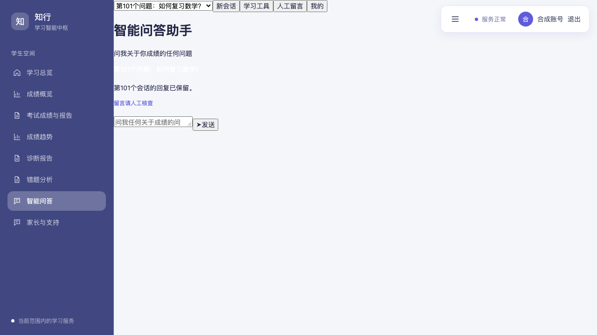
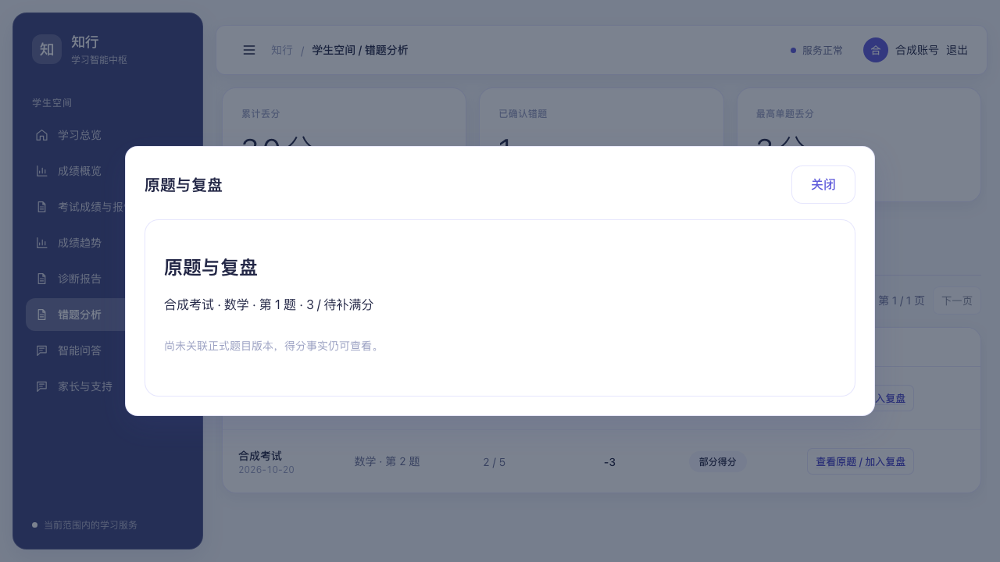
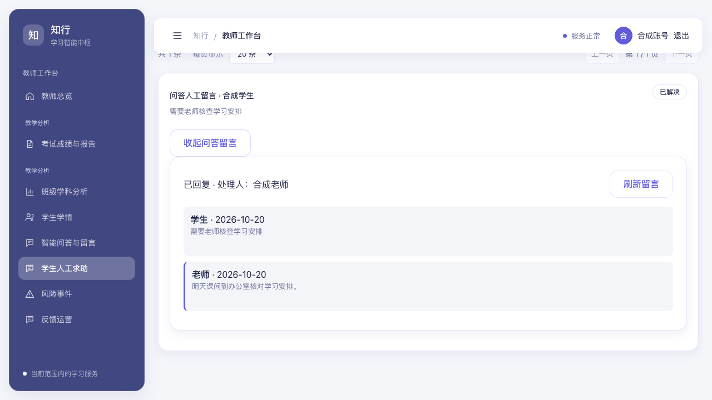

# 问答、任课关系、小题成绩与人工求助修复

日期：2026-10-20（北京时间）。

## 已修复的行为

1. 问答按创建时间倒序读取最近 100 个会话，客户端保持最新会话在前。第 101 个会话提交后、状态重载后、刷新页面后均可继续查看。更早的会话保留在数据库中。
2. 教师档案和考试权限预选共用班级解析，支持全角标点、换行、数字年级班号和“高中一年级26班”。创建或调整考试、班级或学科、导入 CSV、升级换班时，按当前有效教师档案幂等补建任课关系。已有结束或过期的关系不会因补建而恢复。教师导入回执明确提示未匹配引用。
3. 成绩文件可在固定表头后添加“满分”行，首列填写“满分”，各小题列填写该题满分。导入时校验并计算失分。只有得分的旧文件仍可导入，预校验明确提示缺少满分；学生错题页展示得分和“待补满分”，不将其判成错题。考务“查看已导入成绩 → 查看 / 补充小题满分”可补录，保存后计算已有成绩的失分，保留原文件和得分，记录操作。
4. 问答人工留言进入“学生人工求助”和首页人工转接待办。班主任、任课教师按现有学生范围查看、领取和回复；学生在原留言中查看回复、追加和结束。数据上下文还需同时满足学生与处理教师的来源权限。提示词维护继续要求学校管理员权限。

升级换班的追加回归还修正了班级外部编号回退查询的关联：回退只匹配当前学生及当前任课关系，避免其他未绑定班级的学生进入教师范围。

## 验证

- 后端 SQLite 完整套件：326 通过、8 项 PostgreSQL 专用测试跳过；随后增加并通过真实“先教师、再考试、再升级换班”回归。
- 新增与受影响后端定向回归：会话超过 100 条、重试幂等、教师先导入的两种建档顺序、生产式关闭 autoflush、结束及过期任课关系、小题满分导入和补录、越界满分、考试版本冲突、求助队列计数、跨班及跨校隔离、成绩来源权限与撤销。
- 前端单元测试：9 个文件、31 项通过。
- 前端 ESLint、TypeScript 与生产构建通过。
- Chromium 专项测试：3 项通过，覆盖第 101 个会话刷新和重选、待补满分页面和原题详情、老师领取并回复问答人工留言。
- 截图均使用合成身份与合成数据；浏览器测试拦截 API，用于验证交互和展示，真实后端读写由 HTTP/SQL 回归覆盖。

## 页面证据

## 部署与旧数据

使用 `scripts/server/deploy_workflow_gaps.sh`，由 `ubuntu` 登录后 `sudo -n` 执行。脚本备份数据库、校验备份目录、保留 API/Web 回滚镜像，再构建并发布。环境文件和数据库结构不变；校验活动镜像源码、公开前端资源以及业务数据摘要。

`apps/api/scripts/repair_workflow_gaps.py` 默认只预览并回滚；`--apply` 才提交。它补建有效档案缺少的任课关系，只对已知满分且失分为空的小题计算失分，不推算缺失满分。发布后再次预览必须没有可重复补建或修复的记录。

原文件缺少的小题满分仍需学校依据试卷或评分标准补录，不能用其他学生最高分代替。旧问答人工留言直接纳入统一队列，无需复制或迁移。
